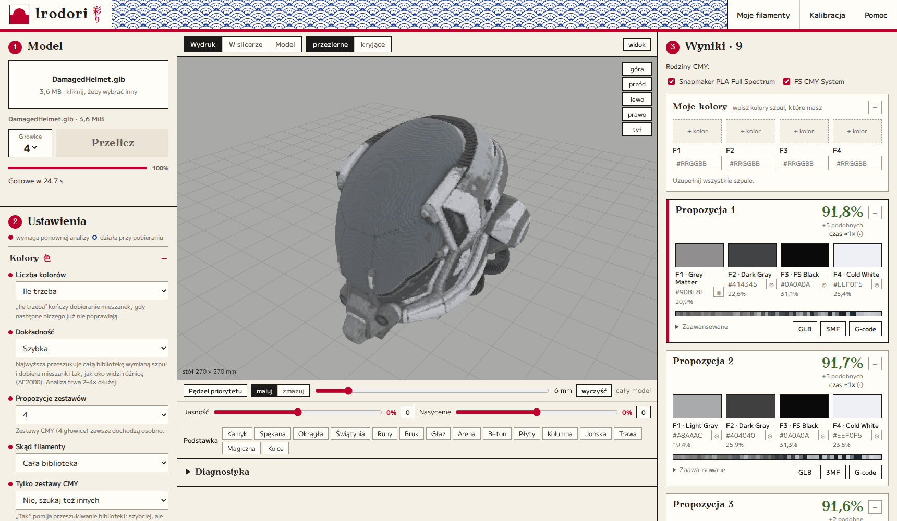

<h1 align="center">Irodori 彩り</h1>

<b>Kolorowy model 3D na wielokolorowy wydruk z 4 szpul na drukarce Snapmaker U1.</b> 
Działa na Twoim komputerze. Bez konta i bez wysyłania modeli do internetu.

Model: „Damaged Helmet”, theblueturtle_, CC BY 4.0. Nie ma go w tym repozytorium.

*English: Irodori turns a coloured 3D model into a multi-colour print project for the Snapmaker U1. The interface and documentation are in Polish. To run it, install Python 3.11+ and start `irodori.py`.*

## Co to robi

Wrzucasz kolorowy model. Irodori:

1. sprawdza, jakie kolory ma model,
2. dobiera 2–4 szpule, z których da się je uzyskać,
3. układa cienkie warstwy różnych szpul tak, żeby z daleka wyglądały jak nowy kolor,
4. pokazuje, jak powinien wyglądać wydruk,
5. zapisuje gotowy projekt dla Snapmaker Orca albo G-code dla drukarki.

## Czego potrzebujesz

| Co | Po co | Czy trzeba? |
|---|---|---|
| [Python 3.11 lub nowszy](https://www.python.org/downloads/) | uruchamia program | **tak** |
| Internet przy pierwszym starcie | jednorazowe pobranie około 400 MB bibliotek | **tak**, potem już nie |
| Przeglądarka | w niej działa okno programu | **tak** |
| Snapmaker Orca 2.4 | otwarcie projektu 3MF albo przygotowanie G-code | **tak**, żeby wydrukować |
| Drukarka Snapmaker U1 | na nią powstaje projekt | **tak**, żeby wydrukować |
| [Blender](https://www.blender.org/download/) | tylko do plików FBX | nie |

## Instalacja krok po kroku

### 1. Pobierz program

Na górze tej strony kliknij zielony przycisk **Code**, a potem **Download ZIP**. Rozpakuj plik, na przykład na Pulpit.

### 2. Zainstaluj Pythona

Pobierz go ze strony [python.org](https://www.python.org/downloads/) i zainstaluj.

> **Windows:** na pierwszym ekranie instalatora zaznacz **Add python.exe to PATH**. To najczęstsza przyczyna problemów.

Na Linuksie Python zwykle już jest. Sprawdzisz to poleceniem `python3 --version`.

### 3. Uruchom Irodori

| System | Co zrobić |
|---|---|
| **Windows** | kliknij dwa razy `Irodori.bat` |
| **macOS** | kliknij prawym przyciskiem `Irodori.command`, wybierz **Otwórz** i potwierdź |
| **Linux** | otwórz terminal w folderze programu i wpisz `./run.sh` |

Pierwszy start trwa kilka minut, bo program pobiera biblioteki. Nie zamykaj okna, nawet jeśli przez chwilę nic się w nim nie zmienia. Potem przeglądarka otworzy się sama. Jeśli tak się nie stanie, wejdź na **http://127.0.0.1:8765/**.

Okno terminala ma zostać otwarte przez cały czas pracy.

## Pierwszy wydruk

1. **Wczytaj model.** Przeciągnij plik na pole **Upuść model albo kliknij**. Działają: GLB, OBJ z MTL, FBX z teksturami i malowany 3MF. Jeśli model potrzebuje dodatkowych plików, program poprosi o nie.
2. **Kliknij Analizuj.** Przy domyślnej dokładności duży model może liczyć się kilka minut.
3. **Wybierz zestaw po prawej.** Procent mówi, jak blisko wynik jest kolorów modelu. Im wyżej, tym lepiej. Kliknięty zestaw zobaczysz w podglądzie.
4. **Włóż pasujące szpule.** Nazwy i kolory są na karcie zestawu. F1 to głowica 1, F2 to głowica 2 i tak dalej.
5. **Pobierz plik.** Kliknij **3MF** i otwórz go w Snapmaker Orca albo kliknij **G-code**, jeśli chcesz od razu plik dla drukarki.
6. **Wydrukuj.** Zacznij od małego modelu.

Masz własne szpule? Wpisz je w **Moje filamenty**. Program pokaże wtedy osobny wynik dla szpul założonych w drukarce. Opis wszystkich ustawień jest w programie pod **Pomoc**.

## Jak zamknąć program

Zamknij okno terminala albo wpisz w nim `Ctrl+C`. Na Linuksie możesz też użyć `./run.sh --stop`.

## Gdy coś nie działa

| Problem | Rozwiązanie |
|---|---|
| `python` nie jest rozpoznany albo okno od razu znika | Zainstaluj Pythona ponownie i zaznacz **Add python.exe to PATH** |
| Pierwszy start stoi w miejscu | Poczekaj. Biblioteki mają około 400 MB. Sprawdź internet |
| Przeglądarka się nie otwiera | Wejdź ręcznie na http://127.0.0.1:8765/ |
| macOS nie chce otworzyć pliku | Kliknij go prawym przyciskiem i wybierz **Otwórz** |
| `Permission denied` na Linuksie | Wpisz `python3 irodori.py` |
| `Nie znaleziono programu Snapmaker Orca` | Zainstaluj Orkę albo pobierz 3MF i otwórz go ręcznie. Możesz też podać ścieżkę w zmiennej `IRODORI_ORCA` |
| `Blender (potrzebny do FBX)` | Zainstaluj Blendera albo zapisz model jako GLB |
| Port 8765 jest zajęty | Ustaw inny w zmiennej `IRODORI_PORT` |
| Model jest biały albo ma złe kolory | Dodaj brakujące tekstury, gdy program o nie poprosi |

Nie ma tu Twojego problemu? [Zgłoś go](https://github.com/Devoane/irodori/issues) i dopisz system, typ pliku oraz treść błędu.

## Jak to działa

Drukarka ma tylko 4 szpule, ale warstwy są bardzo cienkie. Gdy na przemian drukują się warstwy niebieskie i żółte, z daleka oko widzi zieleń. Podobnie działa ekran albo druk w gazecie.

Irodori szuka 2–4 szpul, które razem najlepiej pokrywają kolory modelu, i tworzy z nich do 251 mieszanek. Każdy fragment modelu dostaje najbliższą mieszankę. Do oceny służy ΔE2000, czyli miara różnicy kolorów dopasowana do ludzkiego wzroku.

Pełny opis formatu eksportu, algorytmów i testów jest w [docs/technika.md](docs/technika.md).

## Co warto wiedzieć przed drukiem

- **Tylko Snapmaker U1.** Projekty powstają dla tej drukarki i Snapmaker Orca 2.4. Tryb 5–8 głowic służy tylko do podglądu.
- **Podgląd to przewidywanie.** Prawdziwy kolor zależy od partii filamentu i światła. Kalibracja kartą ma to poprawiać, ale nie została jeszcze sprawdzona na prawdziwym wydruku.
- **Odpad bywa duży.** Mieszanki wymagają wieży czyszczącej. W jednym z testów wieża zużyła 58 g, a sam model 13,5 g.
- **Bardzo duże modele są upraszczane.** Domyślny limit to 1 milion trójkątów.
- **Testowane na Linuksie.** Pliki startowe dla Windows i macOS są gotowe, ale nie były sprawdzane na tych systemach. Jeśli coś nie działa, zgłoś to.

## Prywatność

Program działa tylko na Twoim komputerze i nasłuchuje wyłącznie na adresie `127.0.0.1`. Modele nie są nigdzie wysyłane. Internet jest potrzebny tylko przy pierwszym pobraniu bibliotek.

## Licencja

Kod jest dostępny na licencji [GNU AGPL-3.0](LICENSE). Część danych i logiki koloru pochodzi z OrcaSlicer i Snapmaker Orca.

| Składnik | Licencja |
|---|---|
| Model mieszania FilamentMixer (z Orca) | MIT |
| three.js, three-mesh-bvh | MIT |
| Antykwa Toruńska | GUST Font License |
| M PLUS 1, Shippori Mincho | SIL OFL 1.1 |

Irodori to niezależny projekt, niezwiązany z firmą Snapmaker ani producentami filamentów. Ich nazwy służą tylko do opisania zgodności.
