

<h1 align="center">Kaichō 階調</h1>

<b>Turn a colored 3D model into a multicolor print on a toolchanger 3D printer.</b> 
Runs on your own computer. No account, and your models are never uploaded.

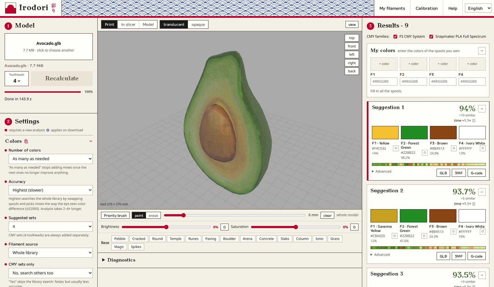

Sample model in all pictures: "Avocado" by Microsoft, CC0 1.0, from the Khronos glTF Sample Assets. It is not included in this repository.

## Who it is for

Kaichō is made for **toolchanger printers**, where each color has its own toolhead. Mixing colors layer by layer means changing filament very often, and a toolchanger can do that without unloading and reloading a single nozzle. Printers with one nozzle and a filament changer (AMS, MMU) are not the target.

| Printer | Status |
|---|---|
| Snapmaker U1 | ready-made export, tested in Snapmaker Orca |
| Other toolchangers | the color analysis and preview work, but the export needs a profile for your printer. [Tell us which one you have](https://github.com/Devoane/kaicho/issues) |

## Languages

English is the main language and what the app starts in. Change it in the top right corner of the app, and your choice is remembered.

| Language | In the app |
|---|---|
| English (default) | English |
| Polish | Polski |
| Spanish | Español |
| German | Deutsch |
| French | Français |
| Russian | Русский |
| Japanese | 日本語 |

## What it does

You drop in a colored model. Kaichō then:

1. looks at which colors the model has,
2. picks 2–4 spools that can produce them,
3. arranges thin layers of different spools so that from a distance they look like a new color,
4. shows you what the print should look like,
5. saves a ready project for Snapmaker Orca, or G-code for the printer.

## See how it works

The pictures below follow one model through the program: a 120 mm avocado, with the other settings left at their defaults. They are screenshots and renders from real files. **This avocado has not been printed, so none of them is a photo of a print.**

### Compare the print with your model

| Model | Print |
|---|---|
| 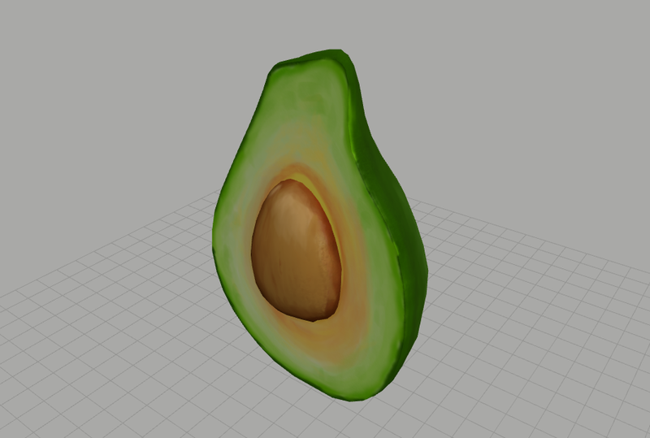 | 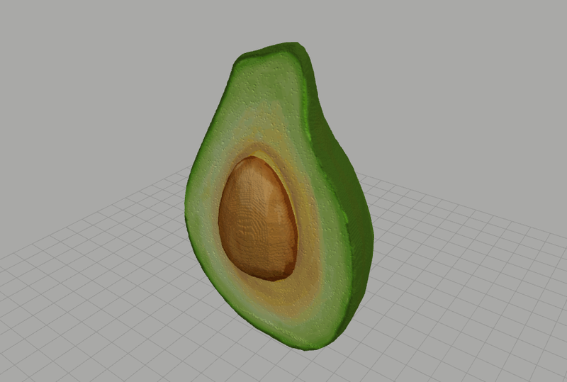 |
| Your file | What the finished print should look like |

A third view, **In slicer**, shows the colors Snapmaker Orca will display for the project. On the default settings it matches **Print**. It can differ when **Two wall recipes** is on.

### Choose your spools

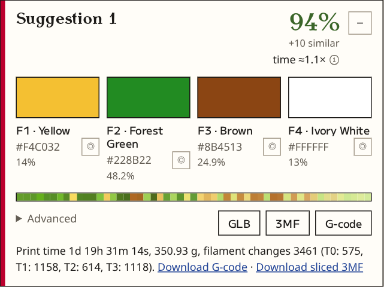

Each result card shows:

- **The match**, here 94%. It says how close the result is to the model's colors.
- **The spools**, with the name, the color, and how much of the colored surface each one covers. F1 goes in toolhead 1, and so on.
- **The color strip**, with every mix this set uses. This one has 53.
- **The relative time.** 1× is the fastest result of the analysis.
- **The downloads:** GLB (the model with the predicted colors), 3MF (a project for Snapmaker Orca) and G-code. After slicing, the card shows the exact time, weight and number of filament changes.

The **Set ranking** estimates many more spool combinations. Click **Calculate** to build the full result for any of them.

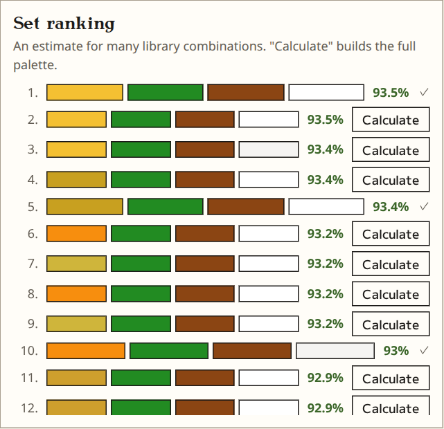

### More toolheads, closer colors

The same model with the best set for each number of toolheads:

| 2 toolheads: 79.4% | 3 toolheads: 91.6% | 4 toolheads: 94% |
|---|---|---|
| 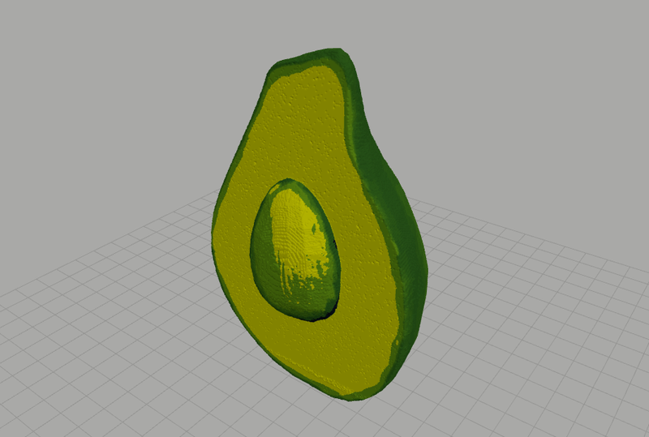 | 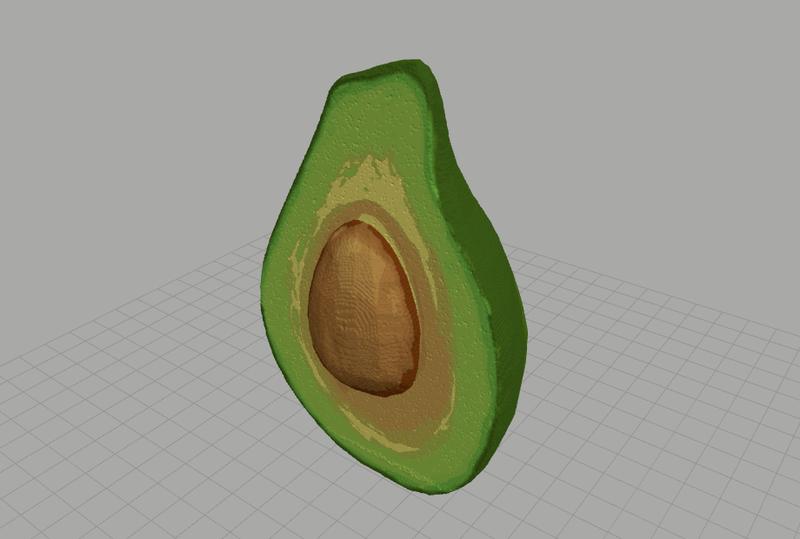 |  |

### What the printer really does

The printer never blends filament. It prints thin layers of pure spool color and changes tools between them, and even a single layer can use several spools. These pictures are drawn from the sliced G-code. They show the outer walls from the front, using only the four spool colors, with one row of pixels for each 0.1 mm of height.

| The whole model | The red box, enlarged 8× (about 11 × 11 mm) |
|---|---|
| 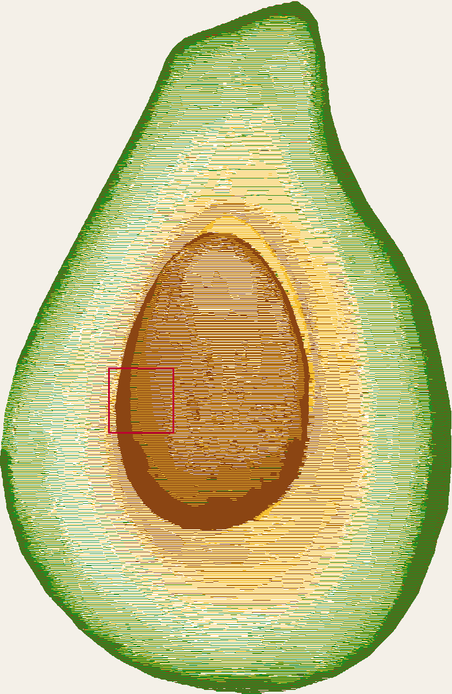 | 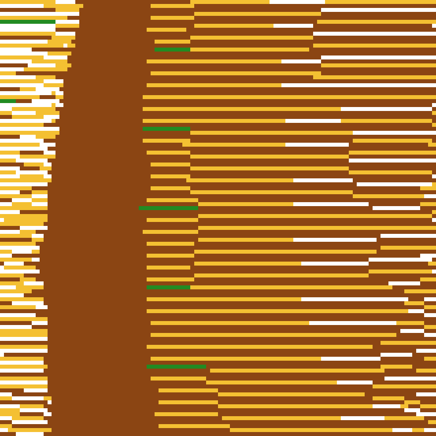 |

### Finish in the slicer

Click **3MF** and open the file in Snapmaker Orca. The printer, spools, color mixes and layer settings are already set. The narrow block in the bed corner is the wipe tower, about 1×1 cm and as tall as the model.

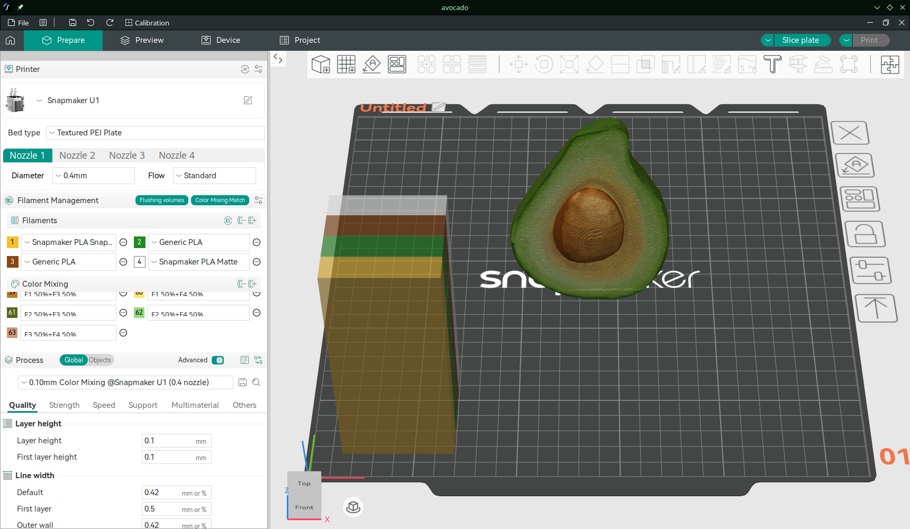

Check the cost before you print. Sliced at 0.08 mm with 4 spools, these sample models give:

| Model | Print time | Filament | Of which wipe tower |
|---|---|---|---|
| Avocado, 120 mm tall | 35 h 13 min | 183.3 g | 12.3 g |
| Duck, 47 mm tall | 5 h 12 min | 25.3 g | 4.5 g |
| Damaged Helmet, 46 mm tall | 14 h 00 min | 49.8 g | 4.9 g |

### Change a suggested color

Click the small circle next to a spool's color. **Repaint the model** shows every part printed with that spool in the new color. **Keep the model's colors** makes the new spools reproduce the original model as closely as they can. The ↺ button brings back the suggestion.

### Other tools

| | |
|---|---|
| 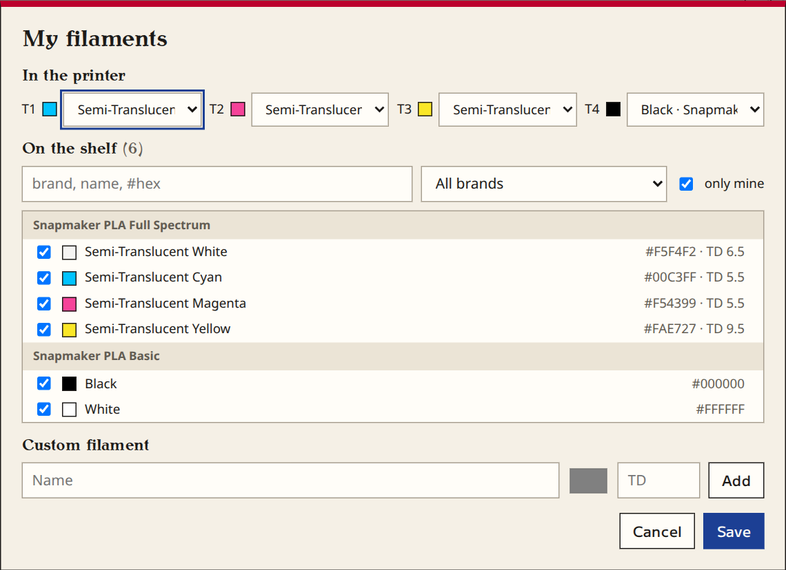 | **My filaments.** Mark the spools you own and what is loaded in the printer. The program then adds a separate result for those spools, and it can search only among the ones you own. |
| 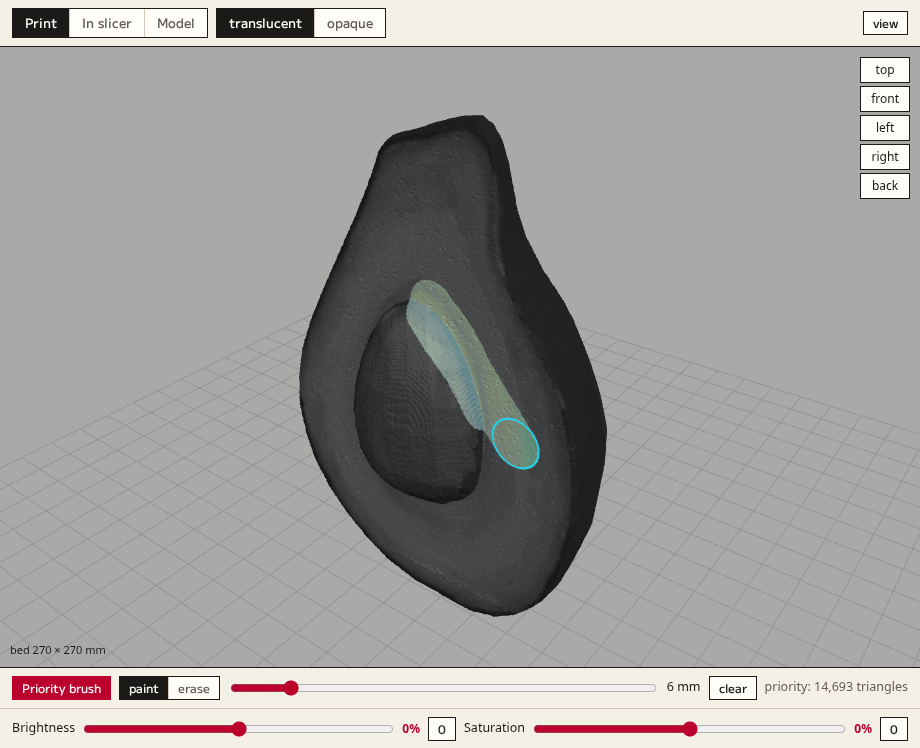 | **Priority brush.** Paint over an important part, such as a face or a logo, and recalculate. Sets are then chosen for that part, and the whole model is still exported. |
| 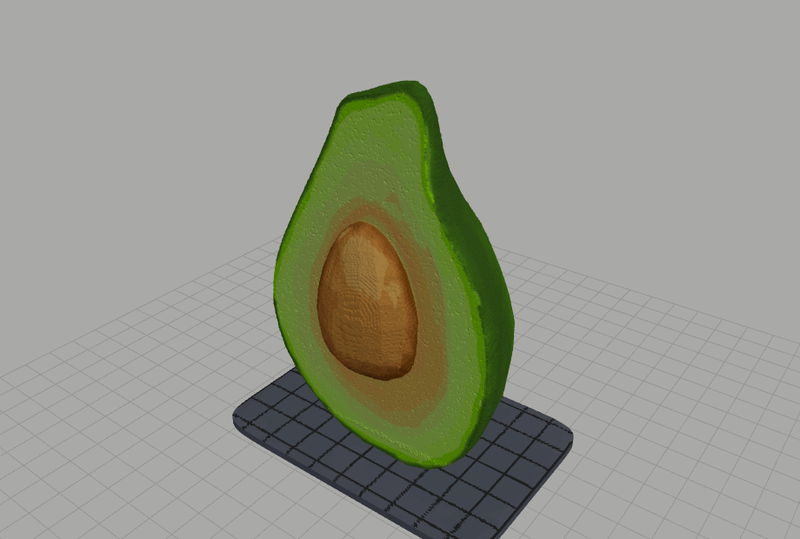 | **Bases.** Add one of 15 display bases. It is printed as part of the same object. |
| 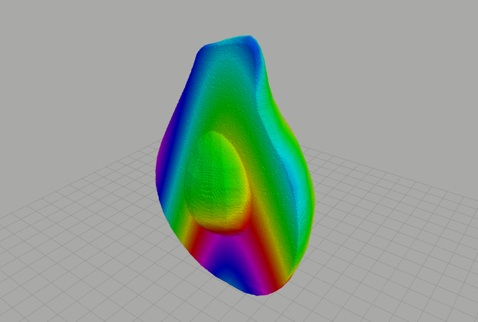 | **Rainbow.** Replace the model's colors with a rainbow spiral. |
| 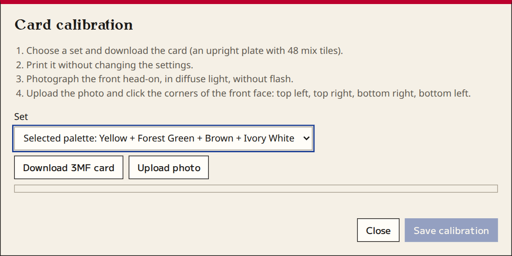 | **Card calibration.** Print a card of color tiles and upload a photo of it, so that predictions can use your real filaments. This has not yet been checked on a real print. |

## What you need

| What | Why | Required? |
|---|---|---|
| Linux or Windows | macOS is not supported | **yes** |
| [Python 3.11 or newer](https://www.python.org/downloads/) | runs the program | **yes** |
| Internet on the first start | one download of about 400 MB of libraries | **yes**, only once |
| A web browser | the program's window opens in it | **yes** |
| Snapmaker Orca 2.4 | opens the 3MF project or prepares the G-code | **yes**, to print |
| A toolchanger printer | prints the project. The ready-made export is for the Snapmaker U1 | **yes**, to print |
| [Blender](https://www.blender.org/download/) | only for FBX files | no |

## Install it step by step

### 1. Download the program

At the top of this page click the green **Code** button, then **Download ZIP**. Unpack the file, for example to your Desktop.

### 2. Install Python

Download it from [python.org](https://www.python.org/downloads/) and install it.

> **Windows:** on the first installer screen tick **Add python.exe to PATH**. Missing this is the most common cause of problems.

Linux usually has Python already. Check with `python3 --version`.

### 3. Start Kaichō

| System | What to do |
|---|---|
| **Windows** | double-click `Kaicho.bat` |
| **Linux** | open a terminal in the program folder and type `./run.sh` |

The first start takes a few minutes because it downloads the libraries. Do not close the window, even if nothing seems to happen for a while. The program then opens in its own browser window, apart from your tabs, cookies and extensions. This needs a Chrome-type browser (Chrome, Edge, Chromium, Brave, Vivaldi) or Firefox. If no window appears, go to **http://127.0.0.1:8765/**.

Keep the terminal window open while you work.

## Your first print

1. **Load a model.** Drag the file onto **Drop a model or click**. GLB, OBJ with MTL, FBX with textures and painted 3MF all work. If the model needs more files, the program asks for them.
2. **Click Analyze.** At the default accuracy a large model can take a few minutes.
3. **Choose a set on the right.** The percentage says how close the result is to the model's colors. Higher is better. The set you click appears in the preview.
4. **Load the matching spools.** The names and colors are on the set's card. F1 is toolhead 1, F2 is toolhead 2, and so on.
5. **Get the file.** Click **3MF** and open it in Snapmaker Orca, or click **G-code** to get a file for the printer right away.
6. **Print.** Start with a small model.

Own some spools already? Enter them under **My filaments**, and the program adds a separate result for the spools in your printer. All the settings are explained in the program under **Help**.

## How to close it

Close the terminal window or press `Ctrl+C` in it. On Linux you can also run `./run.sh --stop`.

## When something does not work

| Problem | Fix |
|---|---|
| `python` is not recognized, or the window closes at once | Reinstall Python and tick **Add python.exe to PATH** |
| The first start seems stuck | Wait. The libraries are about 400 MB. Check your internet |
| The browser does not open | Go to http://127.0.0.1:8765/ yourself |
| `Permission denied` on Linux | Type `python3 kaicho.py` |
| `Program Snapmaker Orca not found` | Install Orca, or download the 3MF and open it by hand. You can also set the path in the `KAICHO_ORCA` variable |
| `Program Blender (needed for FBX) not found` | Install Blender, or save the model as GLB |
| Port 8765 is taken | Set another one in the `KAICHO_PORT` variable |
| The model is white or has wrong colors | Add the missing textures when the program asks for them |

Your problem is not here? [Report it](https://github.com/Devoane/kaicho/issues) and include your system, the file type and the error text.

## How it works

A toolchanger only holds a few spools, but the layers are very thin. When blue and yellow layers alternate, from a distance your eye sees green. A screen or a printed newspaper works in a similar way.

Kaichō looks for the 2–4 spools that together cover the model's colors best and builds up to 251 mixes from them. Each part of the model gets the closest mix. It scores results with ΔE2000, a measure of color difference designed around human vision.

The export format, algorithms and tests are described in [docs/technical.md](docs/technical.md).

## Good to know before printing

- **Export is ready for the Snapmaker U1.** Projects are currently made for this printer and Snapmaker Orca 2.4, and they should not be sent to another printer without its own profile. Export works for 2–4 toolheads; the 5–8 toolhead mode is preview only.
- **The preview is a prediction.** The real color depends on the filament batch and the light. Card calibration is meant to improve this, but it has not yet been checked on a real print.
- **The small wipe tower is untested on real prints.** Each model gets a tower of about 1×1 cm, which is about ten times lighter than before in slicer tests. Whether it stays clean and stable on tall models still needs checking on a printer.
- **Very large models are simplified.** The default limit is 1 million triangles.
- **Tested on Linux.** The Windows launcher is included but has not been tried on that system. If something fails, please report it. macOS is not supported.
- **Translations are unreviewed.** They were written with an AI assistant, and native speakers have not checked them. Filament names stay as the catalog gives them.

## Help translate

Spotted a bad translation, or want your language? Edit the file for your language in [`frontend/i18n`](frontend/i18n) and open a pull request. [docs/technical.md](docs/technical.md) explains how to add a language.

## Privacy

The program runs only on your computer and listens only on `127.0.0.1`. Models are not sent anywhere. Internet is only needed for the first download of the libraries.

## License

The code is available under the [GNU AGPL-3.0](LICENSE). Some of the color logic and data come from OrcaSlicer and Snapmaker Orca.

| Part | License |
|---|---|
| FilamentMixer mixing model (from Orca) | MIT |
| three.js, three-mesh-bvh | MIT |
| Antykwa Toruńska | GUST Font License |
| M PLUS 1, M PLUS 1p, Shippori Mincho | SIL OFL 1.1 |

Kaichō is an independent project, not affiliated with any printer or filament maker. Their names are used only to describe compatibility.

## Contact

devoane911@protonmail.com
